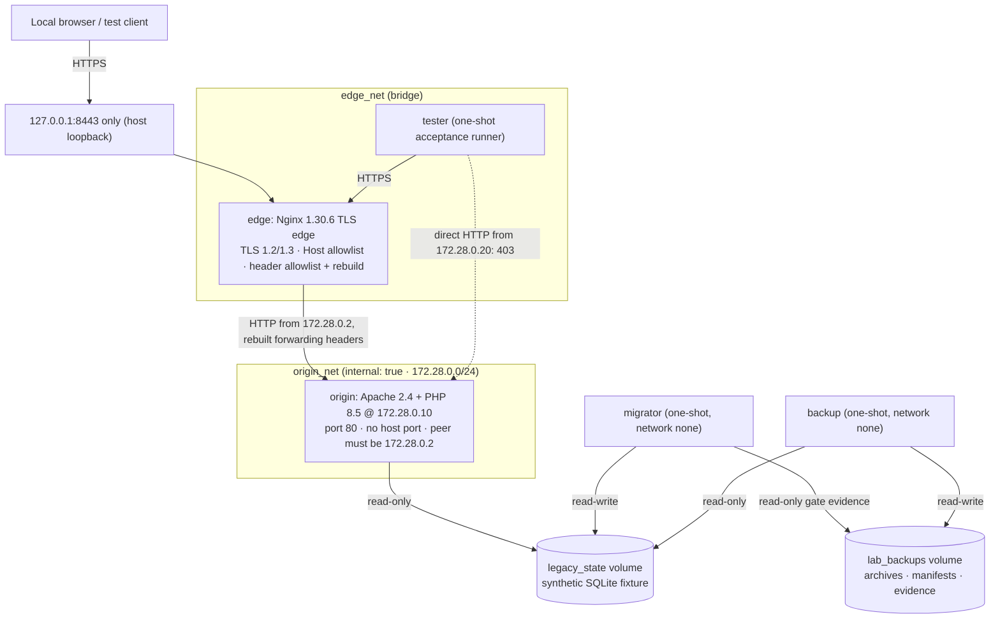

# legacy-web-hardening-lab

> **LAB ONLY — fictional local hardening demonstration; do not use with client data or production systems.**

A small Docker Compose lab that runs on your own machine. It shows selected hardening controls and the
reasoning behind them for a **legacy-style PHP/Apache HTTP origin behind a modern Nginx TLS edge**, on
Windows Docker Desktop (Linux containers).

It is an educational lab with tests. It is **not**:
- a production template or a security certification;
- a Cloudflare deployment;
- a client-system migration or a disaster-recovery guarantee;
- evidence of any compliance.

The edge design is **Cloudflare-style edge/origin separation and header sanitation only**. No
Cloudflare product, account, network or protection is involved.

The spec-driven design (plan, requirements and validation) is in
[`specs/2026-10-31-legacy-web-hardening/`](specs/2026-10-31-legacy-web-hardening/).

## Architecture



| Service | Purpose | Exposure |
|---|---|---|
| `edge` | Nginx TLS edge and hardening layer | **The only host port:** `127.0.0.1:8443 → 443` |
| `origin` | Apache + PHP legacy-style app (`/`, `/health`, `/session`, `/lab/request-context`) | `origin_net` only, no `ports:` |
| `tester` | One-shot containerized acceptance checks | Compose networks only; static `172.28.0.20` on `origin_net` |
| `backup` | One-shot backup, checksum and isolated-restore verifier | `network_mode: none`; named volumes only |
| `migrator` | One-shot SQLite fixture migration control | `network_mode: none`; named volumes only |

**Hardening on every container:**
- `read_only: true` with tmpfs for runtime paths;
- `cap_drop: ALL`, adding back only the capabilities that are needed;
- `no-new-privileges`.

**Images** (explicit tags, no `latest`):
- `nginx:1.30.6-alpine3.24`
- `php:8.5.12-apache-trixie`
- `alpine:3.24.3`

PHP 8.5 is a supported line. "Legacy" describes the application pattern (mod_php, file-per-endpoint,
an HTTP-only origin, file sessions), not an end-of-life runtime. **A real deployment should
independently review and pin image digests;** this lab pins tags only.

## Trust boundaries

1. **Host loopback → edge (TLS).** This is the only browser-facing boundary, bound to `127.0.0.1:8443`.
   - The certificate is a self-signed ECDSA one, valid for 7 days.
   - It's generated at every container start on tmpfs, and is never logged or written to the project.
2. **Edge → origin (internal HTTP).** Traffic is plain HTTP on the `internal: true` network.
   - Apache accepts a request only when its **TCP peer** is the edge's fixed IP `172.28.0.2`.
   - **Lab assumption:** the origin is reached only through TLS ended at the edge. That's why PHP sets
     the `Secure` cookie flag even though this internal hop is HTTP.
3. **Origin → fixture state.** The origin mounts `legacy_state` **read-only**. Only `migrator` writes to
   it.
4. **Static IPs are a local Compose convention.** They make the trusted-proxy allowlist testable. They
   are **not** a production network-policy solution: anything that can claim `172.28.0.2` on that
   network is trusted.

## Prerequisites

- Windows with **Docker Desktop running in Linux-container mode**. `docker info --format '{{.OSType}}'`
  must print `linux`.
- **Host port 8443 free.** `scripts\lab.ps1 up` refuses to start if another process holds it.
- **PowerShell** (Windows PowerShell 5.1 or PowerShell 7).
- **Nothing else on the host:** curl, OpenSSL, PHP, Apache, Nginx and Bash run only inside containers.
- If your execution policy blocks local scripts, run
  `powershell -NoProfile -ExecutionPolicy Bypass -File .\scripts\lab.ps1 <command>`.

## Quick start

From the project root:

```powershell
.\scripts\lab.ps1 up      # build images, seed the synthetic fixture, start edge + origin, wait for /health
.\scripts\lab.ps1 test    # 38 acceptance checks (25 in the tester container + 13 host-side Docker checks)
```

Then open **https://localhost:8443/**.

**Expect a browser certificate warning.** The certificate is self-signed and regenerated each time the
edge starts. Accept it only for this local lab. Never install it as a trusted root.

### All commands

`scripts\lab.ps1` is the only Windows-facing wrapper. It runs with strict PowerShell error handling and
checks every native exit code. Each command writes sanitized evidence to
`artifacts/evidence/<command>.log`.

| Command | What it does |
|---|---|
| `up` | Build, `migrator init` (seed or verify the fixture), start `edge` and `origin`, wait for health |
| `test` | Compose and exposure checks, containerized HTTP/TLS/session tests, hygiene and documentation checks |
| `backup` | Snapshot to an archive plus SHA-256 manifest. The gate then **refuses** apply until this backup is verified. |
| `verify-backup` | Check the manifest, restore into a disposable directory, check integrity and marker, write evidence. The gate then passes. |
| `migrate-status` | Schema version, marker, data digest, gate state, journal |
| `migrate-dry-run` | Apply the migration to a disposable copy and prove the live fixture is unchanged |
| `migrate-apply` | Verified-backup gate → schema 1 → 2. Re-run proves a no-op, then `/health` through the edge. |
| `rollback` | Schema 2 → 1, digest and integrity checks, `/health` through the edge, re-run no-op, gate re-check |
| `down` | Stop and remove containers and networks; **keeps** volumes |
| `reset` | **Destructive.** Requires `-ConfirmLabReset` (see below). |

## What this lab demonstrates

### Origin restriction
- `origin` has no `ports:` and sits only on an `internal: true` network.
- Apache allows a request only when `%{CONN_REMOTE_ADDR} == '172.28.0.2'`, the real TCP peer.
- **Why not plain `Require ip 172.28.0.2`?** `mod_remoteip` rewrites the client address from
  `X-Forwarded-For` *before* authorization runs. `Require ip` would then compare against the forwarded
  client address, and deny every legitimate request through the edge.
- The tests check that a container on the internal network gets **403** going straight to Apache, even
  with a forged `X-Forwarded-For: 172.28.0.2`, while traffic through the edge stays healthy.

### Forwarded-header sanitation
- The edge uses `proxy_pass_request_headers off`, which is an **allowlist**: only `Cookie`,
  `User-Agent`, `Accept` and `Accept-Language` pass through.
- The edge **rebuilds** `Host`, `X-Forwarded-For` and `X-Real-IP` (both set to the client address
  Nginx observed, overwritten rather than appended), plus `X-Forwarded-Proto: https`,
  `X-Forwarded-Port: 443` and `X-Forwarded-Host`.
- So a client's `Forwarded`, `X-Forwarded-*`, `X-Real-IP`, `CF-Connecting-IP` and `True-Client-IP`
  never reach PHP.
- Apache trusts forwarding headers only from `172.28.0.2`, and sets `HTTPS=on` only when that peer
  sent `X-Forwarded-Proto: https`.
- `/lab/request-context` shows only 7 sanitized fields. `x_forwarded_for_unconsumed` must be 0:
  `mod_remoteip` consumes the single entry the edge wrote, so leftovers would reveal an appended chain.

### Edge hardening
- TLS 1.2 and 1.3 only.
- A default server returns **421** for any `Host` other than `localhost` or `127.0.0.1`. The test
  shows such requests never appear in the origin's access log.
- `GET` and `HEAD` only; `TRACE` and other methods get **405**.
- `Server: nginx` without a version, and no `X-Powered-By`.
- Response headers: `X-Content-Type-Options: nosniff`, `X-Frame-Options: DENY`,
  `Referrer-Policy: no-referrer`, and the CSP
  `default-src 'none'; base-uri 'none'; form-action 'none'; frame-ancestors 'none'`. The pages use no
  script, style or images.
- **No HSTS, on purpose.** A persistent HSTS policy for `localhost` would force every unrelated local
  development service on that name to HTTPS in your browser, long after this lab is gone. With a
  self-signed certificate that changes on every start, it adds no value here.
- Apache side: directory listing off (an index-less directory gets a generic 404), `TraceEnable Off`,
  `ServerTokens Prod`, `ServerSignature Off`, generic error bodies.

### Session and cookie behaviour
- `/session` sets exactly one cookie: a host-only `LABSESSID` with `Secure`, `HttpOnly`,
  `SameSite=Lax` and `path=/`. There's no `Domain` and no `PHPSESSID`.
- Settings: `session.use_only_cookies=1`, `use_strict_mode=1`, `use_trans_sid=0`, and
  `Cache-Control: no-store`.
- The tests check that a cookie jar keeps the counter (1, then 2), and that a client-chosen session ID
  is replaced (strict mode). Session IDs are never printed.

### Backup verification
- `backup` creates `lab-backup-<UTC>.tar.gz` plus a `.sha256` manifest from a consistent
  `sqlite3 .backup` snapshot. The live hash must stay the same across the snapshot.
- Each new backup **invalidates** earlier verification evidence.
- `verify-backup` runs `sha256sum -c` and checks the archive's member names. It restores into a
  **disposable `/tmp/restore.*` directory inside the one-shot container**, then checks
  `integrity_check`, the marker `LAB_BACKUP_FIXTURE=v1`, the item count and the schema.
- The live volume is mounted read-only in that container, and a write probe proves it. A restore can't
  overwrite live data.

### Migration with a verified-backup gate
- `migrate-dry-run` applies migration `002_lab_change_log` to a disposable copy. It shows the live
  SHA-256 and schema version are unchanged.
- `migrate-apply` first evaluates the gate, under the write lock:
  1. The evidence must exist and say `verified`.
  2. The archive's checksum must match.
  3. The live database must be byte-identical to the one that was backed up.

  If any of these fails, apply refuses with exit 3 and a `REMEDIATION:` line.
- Apply then moves the schema from 1 to 2 in one transaction and writes a journal row with the data
  digest.

## Rollback

Lab-only procedures:

- **Migration rollback:** `.\scripts\lab.ps1 rollback` reverts only migration `002` (schema 2 → 1).
  - It checks that the fixture marker is intact, that the data digest equals the one recorded at apply,
    and that `integrity_check` passes.
  - It then checks `/health` through the edge, and shows that running it again changes nothing.
  - Afterwards the gate **refuses** a new apply until a fresh backup is verified, because the live file
    changed.
- **Service rollback:** `.\scripts\lab.ps1 down` keeps the volumes; `up` brings the same state back.
- **Fixture rebuild:** there is deliberately **no "restore over live" command**. To start from a fresh
  fixture, run `reset -ConfirmLabReset` and then `up`.

## What this lab does not demonstrate

**No proof of:**
- recovery point or recovery time objectives (RPO/RTO);
- encrypted, offsite or immutable backups;
- disaster recovery or production migration safety;
- that live rollback is suitable.

**No real controls for:**
- access-control policy or authentication;
- CSRF protection (the lab has no state-changing forms);
- a WAF, rate limiting or bot protection;
- performance, monitoring or alerting.

**It is not:**
- a real network policy (static Compose IPs aren't strong identity);
- a real certificate or secret management setup.

**It makes no claim about:**
- Cloudflare: no product, account or network is used, and this lab is not Cloudflare-protected;
- compliance: the lab is not compliant with PCI DSS, SOC 2, HIPAA or any other framework, not certified,
  not production-ready and not fully secure;
- client data: it is never suitable for client data.

## Tests

```powershell
.\scripts\lab.ps1 test
```

Each check prints `PASS <ID> ...` or `FAIL <ID> ...`. The IDs map to requirements in
[`validation.md`](specs/2026-10-31-legacy-web-hardening/validation.md).
- **In the `tester` container (25 checks):** TLS, edge, forwarding, origin and session.
- **On the host (13 checks):** `docker compose config` and `ps`, the loopback-only listener, Host-probe
  absence from the origin logs, wrapper discipline, the reset guard, tree hygiene, and documentation.
- **In the lifecycle commands:** 15 more checks (`V-DATA`, `V-BAK`, `V-MIG`, `V-RB`).

See [`tests/acceptance/README.md`](tests/acceptance/README.md) for the full catalogue. Re-running the
lifecycle is idempotent; anything that can't proceed prints a precise `REMEDIATION:` line.

## Troubleshooting

| Symptom | What to do |
|---|---|
| `Docker Desktop is not reachable` | Start Docker Desktop, wait for "Engine running", then retry. |
| `Docker reports OSType 'windows'` | Switch Docker Desktop to Linux containers yourself, then retry. The script never switches modes. |
| `Host port 8443 is already in use` | Find the owner with `Get-NetTCPConnection -LocalPort 8443` and free it deliberately. Don't stop unrelated processes blindly. |
| `Pool overlaps with other one on this host` | Another Docker network uses `172.28.0.0/24`. Remove that network if it's yours, or change the lab subnet and IPs consistently in the compose file, the Apache vhost, `nginx.conf`, the tester and the specs. |
| `GATE REFUSED` on `migrate-apply` | Expected after a rollback or a new backup. Run `backup`, then `verify-backup`, then retry. |
| Browser shows a certificate warning | Expected: the certificate is self-signed for local use only. |
| A check fails | Read the `FAIL` line and `artifacts/evidence/<command>.log`. Inspect `docker compose -p legacy-web-hardening-lab logs edge origin`. |

## Safe shutdown

```powershell
.\scripts\lab.ps1 down
```

This stops and removes only this project's containers and networks. The named volumes
(`legacy_state` and `lab_backups`) are **kept**, so `up` resumes with the same fixture and backups.

## Destructive reset

```powershell
.\scripts\lab.ps1 reset -ConfirmLabReset
```

> **Warning:** this permanently deletes this lab's synthetic fixture and every backup archive. It runs
> `docker compose -p legacy-web-hardening-lab down --volumes --remove-orphans`.

- It removes **only** this Compose project's containers, networks and named volumes. It never runs
  `docker system prune`, `docker volume prune` or any other global cleanup.
- Locally built images are kept.
- Without `-ConfirmLabReset`, it refuses, exits 2 and changes nothing.

## Before adapting elsewhere

Before adapting any idea from this lab to a real system, at minimum:

- [ ] Write a **threat model** specific to that system and its data.
- [ ] Use **real certificate and secret management**: a trusted CA, rotation and protected key storage.
  Never self-signed certificates in production.
- [ ] Replace static-IP trust with a real **network policy**: segmentation, firewalling, and mTLS or
  authenticated proxy identity.
- [ ] Review the **trusted proxy list**, which headers are rebuilt, and the CDN or edge provider's
  documented client-IP headers.
- [ ] Define **backups** with RPO/RTO, encryption, offsite and immutable copies, and tested restores.
- [ ] Add **monitoring and alerting** for the edge, the origin and backup jobs.
- [ ] Run **performance and load testing**.
- [ ] Get an independent **peer review and security review**.
- [ ] Follow **change approval** in a maintenance window, with a communication plan.
- [ ] **Rehearse rollback** on a production-like copy, and set criteria for when to stop.
- [ ] Pin and review **image digests and package versions**, and keep them patched.

## Project layout

```text
docker-compose.yml               single Compose file (project: legacy-web-hardening-lab)
docker/edge/                     Nginx Dockerfile, nginx.conf, entrypoint.sh (ephemeral TLS)
docker/origin/                   PHP/Apache Dockerfile, vhost, hardening conf, PHP ini, public/, lib/, bin/
docker/backup/                   backup-verify.sh (create / verify with isolated restore)
docker/tester/                   run-acceptance.sh (containerized acceptance checks)
scripts/lab.ps1                  the only Windows-facing wrapper
specs/2026-10-31-legacy-web-hardening/   plan.md, requirements.md, validation.md
tests/acceptance/README.md       acceptance test catalogue
artifacts/README.md              disposable, Git-ignored evidence location
BUILD_REPORT.md                  build and validation record
```

## License

No license has been chosen yet; that's the owner's decision.
