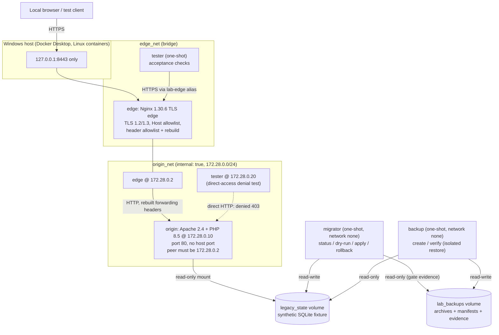

# Plan — legacy-web-hardening-lab (2026-10-31)

> **LAB ONLY — fictional local hardening demonstration; do not use with client data or production systems.**

## 1. Purpose and scope

This plan describes a small, tested, **local-only** Docker Compose lab. It shows selected controls and
operational reasoning for a legacy-style PHP HTTP origin running behind a modern local TLS reverse
proxy on Windows Docker Desktop (Linux containers).

**In scope:**
- **Network and TLS:**
  - An Nginx TLS edge bound only to `127.0.0.1:8443`.
  - An Apache + PHP origin with no host port, reachable only from the edge's fixed internal IP.
- **Request handling:**
  - Forwarded headers sanitized and rebuilt at the edge, with a documented trusted-proxy boundary.
  - Secure PHP session cookies through the HTTPS edge.
- **Data operations:**
  - A synthetic SQLite fixture.
  - A backup with a checksum manifest, verified by restoring it to a separate, disposable location.
  - A controlled, reversible fixture migration: status, dry-run, verified-backup gate, apply and rollback.
- **Tooling:**
  - Containerized acceptance tests.
  - One narrowly scoped PowerShell wrapper (`scripts/lab.ps1`).

**Non-goals:** This is **not**:
- a production template or a security certification;
- a Cloudflare deployment or product integration;
- a client-system migration or a disaster-recovery guarantee;
- evidence of any compliance (PCI DSS, SOC 2, HIPAA or other).

It also does not use real domains, credentials, certificates, IPs, datasets or user records, and it
doesn't expose a public endpoint or create a tunnel.

## 2. Threat model (lab-scoped)

| Actor or event | Capability assumed | Control demonstrated | Residual (not addressed) |
|---|---|---|---|
| Local HTTP client (browser or test client) | Sends arbitrary headers, methods and `Host` values to `127.0.0.1:8443` | Host allowlist (421), method allowlist (405), forwarded-header rebuilding, security headers | Client-side compromise; local malware on the host |
| Client forging `X-Forwarded-For`, `Forwarded`, `X-Real-IP`, `CF-Connecting-IP` or `True-Client-IP` | Tries to spoof the client IP, scheme or host the app sees | The edge forwards only allowlisted request headers and rebuilds the forwarding headers. The origin trusts forwarding headers only from `172.28.0.2`. | A compromised edge container can still assert anything |
| Container on the internal origin network, other than the edge | Talks HTTP straight to Apache | Apache denies any connection whose peer isn't `172.28.0.2`. That check runs at connection level, so the rewritten client IP can't satisfy it. | Static Compose IPs aren't strong identity; anything that can join the network with that IP is trusted |
| Session-fixation attempt | Presents an attacker-chosen session ID | `session.use_strict_mode=1`, cookie-only sessions, no URL session IDs | No CSRF tokens, because the lab has no state-changing forms |
| Operator error during migration | Runs apply without a current backup, or against changed data | Verified-backup gate, dry-run on a disposable copy, journal, rollback with data-digest check | Encrypted backups, off-host copies, RPO/RTO targets |
| Accidental data loss | Restore aimed at the live volume | The backup container mounts the live volume **read-only**, and restores go into a disposable directory inside the container | Real backup retention, immutability or offsite policy |

## 3. Trust boundaries

1. **Host loopback → edge (TLS):** the only browser-facing boundary, `127.0.0.1:8443 → edge:443`. The
   self-signed certificate is created when the container starts and is never stored in the project.
2. **Edge → origin (internal HTTP):** plain HTTP on the `internal: true` network `origin_net`.
   - **Assumption:** the origin is reached only through TLS ended at the edge. That's why PHP sets the
     `Secure` cookie flag even though the internal hop is HTTP.
   - The origin enforces this assumption at connection level: the peer must be `172.28.0.2`.
3. **Origin → fixture state:** the origin mounts the `legacy_state` volume **read-only**. Only the
   one-shot `migrator` writes to it.
4. **One-shot helpers:**
   - `tester` joins both networks to run its checks;
   - `backup` and `migrator` run with `network_mode: none` and touch only named volumes.

## 4. Topology

**Static internal IPs**, set only on `origin_net`:
- edge `172.28.0.2`
- origin `172.28.0.10`
- tester `172.28.0.20`

These are a **local Compose convention**, so that Apache's trusted-proxy allowlist can be tested. They
aren't a production network-policy solution, which would need real network segmentation, mTLS or
authenticated proxy identity.

## 5. Key design decisions

### 5.1 Edge (Nginx)
- **TLS:**
  - At startup, `entrypoint.sh` generates an ECDSA P-256 self-signed certificate with a 7-day lifetime
    and SANs `DNS:localhost` and `IP:127.0.0.1`.
  - It's written to a `tmpfs` (`/run/lab-tls`), so a new one is created on every container start. It's
    never logged and never stored in the project tree.
  - Only `ssl_protocols TLSv1.2 TLSv1.3` are enabled.
- **Host allowlist:**
  - The `default_server` returns a deterministic **421** with a plain-text body. Unknown `Host`
    values never reach the origin.
  - The allowed names are `localhost` and `127.0.0.1`.
- **Methods:** only `GET` and `HEAD` are allowed. Everything else, including `TRACE`, gets **405**.
- **Header allowlist:** `proxy_pass_request_headers off`. The edge passes only `Cookie`, `User-Agent`,
  `Accept` and `Accept-Language`, and rebuilds:
  - `Host` (the matched allowlisted name);
  - `X-Forwarded-For` and `X-Real-IP` (= `$remote_addr`, **overwritten**, never appended);
  - `X-Forwarded-Proto: https`, `X-Forwarded-Port: 443` and `X-Forwarded-Host`.

  So a client's `Forwarded`, `X-Forwarded-*`, `X-Real-IP`, `CF-Connecting-IP`, `True-Client-IP` and any
  other header never reach PHP. This is an allowlist, which is stronger than trying to strip a list of
  known bad headers.
- **Response headers:**
  - `X-Content-Type-Options: nosniff`, `X-Frame-Options: DENY` and `Referrer-Policy: no-referrer`.
  - `Content-Security-Policy: default-src 'none'; base-uri 'none'; form-action 'none'; frame-ancestors 'none'`.
    The lab pages use no script, style or images.
  - `server_tokens off`; origin `X-Powered-By` and `Server` details are hidden.
- **HSTS is deliberately left out.** A persistent `Strict-Transport-Security` policy on `localhost`
  would pin every local development service on that host name to HTTPS in the browser, long after the
  lab is gone. Because the certificate is self-signed and regenerated on every start, HSTS adds no
  value here.
- **Label:** this is **Cloudflare-style edge/origin separation and header sanitation only**. It uses no
  Cloudflare product, account, network or protection.

### 5.2 Origin (Apache + PHP)
- **Image:** a custom image on `php:8.5.12-apache-trixie`, a supported PHP line. The "legacy" part is
  the application pattern: file-per-endpoint PHP, mod_php, an HTTP-only origin and file sessions. It is
  not an end-of-life runtime.
- **Listening:** `Listen 80` only, with no TLS listener. The service has no `ports:` entry and joins
  only `origin_net`.
- **Access restriction, and why it doesn't use plain `Require ip`:**
  - `mod_remoteip` rewrites the client address from `X-Forwarded-For` **before** Apache checks access.
  - Once it's enabled, `Require ip 172.28.0.2` would compare against the *forwarded* client IP, so it
    would deny all legitimate traffic through the edge.
  - The lab therefore checks the TCP connection peer directly: `Require expr "%{CONN_REMOTE_ADDR} == '172.28.0.2'"`.
  - This is exactly the "only the edge's fixed IP" rule, and a forged `X-Forwarded-For` can't satisfy it.
- **`mod_remoteip`:** `RemoteIPHeader X-Forwarded-For` with `RemoteIPInternalProxy 172.28.0.2` only.
  - `mod_remoteip` removes the `X-Forwarded-For` entries it consumes from that trusted proxy.
  - Because the edge overwrites the header with exactly one address, PHP normally sees no remaining
    `X-Forwarded-For` at all.
  - `/lab/request-context` reports the leftover count as `x_forwarded_for_unconsumed`. It must be 0;
    a value above 0 would reveal an appended, client-controlled chain.
- **HTTPS context:** `HTTPS=on` is set only when the connection peer is the edge **and** the edge sent
  `X-Forwarded-Proto: https`.
- **Hardening:**
  - `autoindex` and `status` modules disabled;
  - `Options -Indexes`, `AllowOverride None`, `TraceEnable Off`;
  - `ServerTokens Prod`, `ServerSignature Off`, `FileETag None`;
  - generic `ErrorDocument` strings.
- **PHP:**
  - `expose_php=Off`, `display_errors=Off`, `allow_url_fopen=Off`, `allow_url_include=Off`;
  - `open_basedir` (Apache only) and `disable_functions` for process execution;
  - cookie-only strict sessions named `LABSESSID`, with `Secure`, `HttpOnly`, `SameSite=Lax`, no
    `Domain`, and `nocache`.
- **Endpoints:**
  - `/` is the landing page with the lab-only warning;
  - `/health` returns `{"status":"ok"}` or 503;
  - `/session` is a session counter;
  - `/lab/request-context` returns a fixed set of sanitized fields only.

### 5.3 Fixture, backup and migration
- **Fixture:**
  - `migrator init` seeds `/var/lib/lab/state/lab.sqlite` in `legacy_state`. It creates
    `lab_meta(fixture_marker = LAB_BACKUP_FIXTURE=v1)`, three fictional `lab_items` rows, and an empty
    `lab_migration_journal`, with `PRAGMA user_version = 1`.
  - Seeding writes a temporary file and renames it into place in one step. Running `init` again only
    verifies the existing fixture.
- **Backup `create`** (the backup container mounts the state volume read-only):
  1. Hash the live DB.
  2. Take a snapshot with `sqlite3 .backup`, then hash the live DB again; both hashes must match.
  3. Run `integrity_check` on the snapshot.
  4. Write `backup-meta.env` and `CONTENTS.sha256`.
  5. Create `archives/lab-backup-<UTC>.tar.gz` plus a `.sha256` manifest.
  6. Point `archives/LATEST` at it.
  7. **Invalidate** any earlier verification evidence.
  8. Keep the newest 5 archives.
- **Backup `verify`:**
  1. Run `sha256sum -c` on the manifest.
  2. Check that the archive contains only the expected member names.
  3. Restore into `mktemp -d /tmp/restore.XXXXXX` inside the one-shot container. This location is
     disposable and is never the live volume.
  4. Check `CONTENTS.sha256`, `integrity_check`, the fixture marker, the item count and the schema
     version against the metadata.
  5. Prove the live mount is read-only.
  6. Write `verified/latest.json` atomically.
- **Migration `002_lab_change_log`** adds the metadata table `lab_change_log` and moves the schema from
  version 1 to 2.
  - `status` prints the version, marker, data digest, live SHA-256 and gate state.
  - `dry-run` runs the migration on a disposable copy in `/tmp`. It asserts the live SHA-256 and
    version are unchanged.
  - `apply` first passes the **verified-backup gate**:
    1. The evidence file exists and says `verified`.
    2. The archive exists and its SHA-256 matches the evidence.
    3. The evidence's live SHA-256 equals the current live DB's SHA-256.

    Then, in one transaction, it creates the table, writes the journal row (with the data digest) and
    sets `user_version=2`. Running `apply` again is a no-op.
  - `rollback`, in one transaction, drops the table, writes a journal row and sets `user_version=1`.
    Afterwards it checks: version 1, table gone, marker intact, data digest equal to the one recorded at
    apply, and `integrity_check` ok. Running it again is a no-op. The wrapper then checks `/health`
    through the edge.
- **Gate checks in the wrapper:**
  - Between `backup` and `verify-backup`, the gate must **refuse**: exit 3 with a remediation message.
  - After `verify-backup`, it must pass.
  - After a real rollback, it must refuse again, because the live file changed.

## 6. Implementation phases

1. Write the SDD files: this plan, requirements and validation. They come before any code.
2. Write Compose topology: networks, static IPs, volumes, profiles, one published port.
3. Build the edge: Dockerfile, entrypoint (ephemeral TLS), `nginx.conf`.
4. Build the origin: Dockerfile, vhost, hardening config, PHP ini, pages, `lib/`, healthcheck, `migrate.php`.
5. Add the backup helper: Dockerfile, `backup-verify.sh`.
6. Add the tester: Dockerfile, `run-acceptance.sh`.
7. Write `scripts/lab.ps1` with host-side Docker checks.
8. Write the README, the acceptance README, the artifacts README and `BUILD_REPORT.md`.
9. Run the full validation sequence; check for idempotency and the explicit reset flag.

## 7. Risk controls

| Risk | Control |
|---|---|
| The origin port leaks to the host | No `ports:` on origin, and only `origin_net`, which is `internal: true`. Checked by V-CFG-02/03 and V-RUN-01. |
| The edge binds a public interface | `127.0.0.1:8443:443`, checked by V-CFG-02, V-RUN-01 and V-RUN-02 |
| A forged forwarding header changes the app's view of the request | Header allowlist plus rebuilding, and a single trusted proxy. Checked by V-FWD-01/02 and V-ORIGIN-02. |
| A certificate or key is stored in the project | Generated on `tmpfs` at startup; ignore rules; hygiene scan V-HYG-01 |
| A restore overwrites live data | Live volume mounted read-only in `backup`; disposable restore directory; checked by V-BAK-04 |
| A migration runs without a recoverable copy | Verified-backup gate, checked by V-BAK-02, V-BAK-05 and V-MIG-03 |
| A rollback damages data | Data digest recorded at apply and compared after rollback, plus `integrity_check` (V-RB-01) |
| Destructive cleanup reaches beyond the lab | `reset` needs `-ConfirmLabReset` and runs only `docker compose -p legacy-web-hardening-lab down -v --remove-orphans`. No global prune, ever. |
| A floating image tag changes behaviour | Explicit image tags only (V-CFG-04). Digests are recommended before any real use. |

## 8. Image and version strategy

| Image | Tag | Role |
|---|---|---|
| `nginx` | `1.30.6-alpine3.24` | Edge (stable line). `openssl` is installed from the Alpine 3.24 repository at build time. |
| `php` | `8.5.12-apache-trixie` | Origin and migrator (a supported PHP 8.5 line; Apache 2.4 on Debian trixie) |
| `alpine` | `3.24.3` | Tester and backup helpers (`bash`, `curl`, `openssl`, `jq`, `sqlite`) |

- Explicit tags are pinned, and no `latest` or bare-major tags are used.
- Alpine packages are resolved from the pinned release's repository at build time, without exact
  package pins.
- **A real deployment should independently review and pin image digests (`@sha256:...`) and package
  versions.** This lab doesn't.

## 9. Rollback rehearsal and procedures (lab only)

- **Migration rollback:** `.\scripts\lab.ps1 rollback`. It reverts only migration `002`, checks the data
  digest and integrity, then checks `/health` through the edge.
- **Service rollback:** `.\scripts\lab.ps1 down` stops containers and keeps the volumes. Run `up` again
  to restore service.
- **Fixture restore:** a verified archive can be inspected in the disposable restore. The lab
  deliberately has **no** "restore over live" command. To rebuild the fixture from scratch, run
  `reset -ConfirmLabReset` and then `up`.

## 10. Limitations

**What the lab does not prove:**
- RPO/RTO, encrypted or offsite backups, disaster recovery, production migration safety, access-control
  policy, or that live rollback is suitable.
- That static Compose IPs are strong identity.
- Performance under load. No WAF, rate limiting or bot protection is included.

**Constraints:**
- The certificate is self-signed, so browsers will warn.
- It runs on a single host only.
- Image packages aren't pinned to digests.
